# ITCS6114.Project2

Written by Daniel Willett on 11/09/2026 for UNCC class ITCS-6114-U02.

I wrote my own graph classes for this assignment, which are in the [Graphs](https://github.com/DanielWillett/ITCS6114.Project2/tree/main/ITCS6114.Project2.Impl/Graphs) folder.

Directed graphs and Undirected graphs are separate. Not sure that was a good decision but it worked out pretty well.

**Classes:**
* **Digraph<TData, TCost>**
* **DigraphNode<TData, TCost>**
* **DigraphEdge<TData, TCost>**
* **UndirectedGraph<TData, TCost>**
* **UndirectedGraphNode<TData, TCost>**
* **UndirectedGraphEdge<TData, TCost>**

I used generics for the data in the node and the cost. `TCost` is the type of the cost variable, such as `int` or `double`. `TData` is the type of value used as the label for each node, such as `int`, `char`, or `string`.

Both node classes have a `UserIndex` field that is used to keep track of extra information about the graph node for each algorithm.

No AI was used for this assignment.

## Running Instructions
Install the [.NET SDK](https://dotnet.microsoft.com/en-us/download) if you don't already have it. Install .NET 10 SDK or higher

## Unit Testing
All algorithms and the graph classes have a few [unit tests](https://github.com/DanielWillett/ITCS6114.Project2/tree/main/ITCS6114.Project2.Tests).

Run them using:
```batch
dotnet test
```

## Shortest Path
> Find shortest path tree in both directed and undirected weighted graphs for a given source vertex. Assume there is no negative edge in your graph. You will print each path and path cost for a given source.

My implementation uses Dijkstra's Algorithm for finding the shortest path to all nodes from a given node.

### Run
Requires a graph text file in the format specified in the assignment desc.
```batch
dotnet run --project ITCS6114.Project2 -- spath <filename> [-s <srcNode>] [-m <directed|undirected>]
```
ex (should be ran in repository root), sp-1 is undirected, sp-2 is directed:
```batch
dotnet run --project ITCS6114.Project2 -- spath ITCS6114.Project2.Tests\Assets\sp-1.txt
dotnet run --project ITCS6114.Project2 -- spath ITCS6114.Project2.Tests\Assets\sp-2.txt
```

### Psuedocode

* [Implementation (Directed)](https://github.com/DanielWillett/ITCS6114.Project2/blob/main/ITCS6114.Project2.Impl/Algorithms/ShortestPath.cs#L113)
* [Implementation (Undirected)](https://github.com/DanielWillett/ITCS6114.Project2/blob/main/ITCS6114.Project2.Impl/Algorithms/ShortestPath.cs#L208)

**Dijkstras(src)**
```
input(node src)
output(Dictionary of nodes to paths)

queue = PriorityQueue based on node.d

foreach node n in graph
    n.d = 0 if n same as src, otherwise inf
    n.p = nil
    if n same as src
        queue.add(n)

while queue not empty
    n1 = queue.removeMin()
    if n1.finalized is true
        continue

    foreach edge e from node
        n2 = e.otherNode
        if n2.finalized is true
            continue

        distance = n1.d + e.distance
        if n2.d <= distance
            continue

        n2.d = distance
        n2.p = n1
        queue.add(n2)

    n1.finalized = true

map = Dictionary mapping nodes to paths
foreach node n in graph where n.d not infinite
    map[n] = Trace(n)

return map
```

**Trace(n)**
```
input(node)
output(path - list of nodes)

out = list: { node }

while node.p != nil
    node = node.p
    list.add(node)

// optionally reverse list, my implementation doesn't (it's reversed at presentation time instead).

return list
```

### Complexity Analysis

The runtime can be analyzed by separating sections of the pseudocode.

> n = # of nodes, m = # of edges

* The first loop is `O(n)`.
* The queue will have anywhere between n and 2n elements added, so we can say it runs `<= 2n` times.
    * Each iteration loops through all edges eminating from each node.
        * Since each edge is visited only once, we can say it's a `O(n + m)` complexity. s.
        * Each edge is added to the queue again when it's distance is decreased, which is an `O(log n)` operation.
    * The entire queue loop would be `O((n + m)(log n))`.

* The third loop isn't really part of the algorithm, just prepares the paths in a list format.

So adding the first two loops gets a time complexity of `O((n + m)(log n))`.

The algorithm has a space complexity of `O(3n)` or just `O(n)` since the queue can become at most `2n` elements and extra info about the nodes are stored in a separate array (size `n`).

### Data Structures

* **Priority Queue**
    * Used to keep track of the edges with the shortest running distances.
    * Makes it so finding the shortest edge is `O(1)` and updating the distance is `O(log n)`.
    * I'm using the [built-in .NET PriorityQueue](https://learn.microsoft.com/en-us/dotnet/api/system.collections.generic.priorityqueue-2) class for this, which uses an array-based heap.
* **Array**
    * An array is used to store each node's state separate from the actual `Graph` classes.
        * `O(1)` access time since the index is stored on the graph node.
        * `O(n)` space complexity.

### Tests

#### sp-1.txt

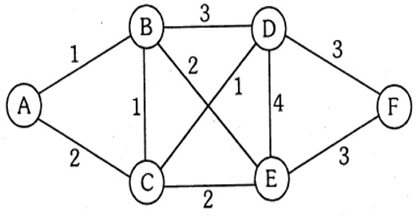

This graph was taken from the project assignment page. It is undirected.

**Run**
```
dotnet run --project ITCS6114.Project2 -- spath ITCS6114.Project2.Tests\Assets\sp-1.txt
```

**Results**
```
Shortest paths from A to:
Node: A
      { Cost = 0, Edges = A }
Node: B
      { Cost = 1, Edges = A -> B }
Node: C
      { Cost = 2, Edges = A -> C }
Node: D
      { Cost = 3, Edges = A -> C -> D }
Node: E
      { Cost = 3, Edges = A -> B -> E }
Node: F
      { Cost = 6, Edges = A -> B -> E -> F }
```

#### sp-2.txt

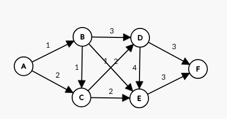

This graph is a variation of the one taken from the project assignment page which has directed edges.

**Run**
```
dotnet run --project ITCS6114.Project2 -- spath ITCS6114.Project2.Tests\Assets\sp-2.txt
```

**Results**
```
Shortest paths from A to:
Node: A
      { Cost = 0, Edges = A }
Node: B
      { Cost = 1, Edges = A -> B }
Node: C
      { Cost = 2, Edges = A -> B -> C }
Node: D
      { Cost = 3, Edges = A -> B -> C -> D }
Node: E
      { Cost = 3, Edges = A -> B -> E }
Node: F
      { Cost = 6, Edges = A -> B -> E -> F }
```

#### sp-3.txt

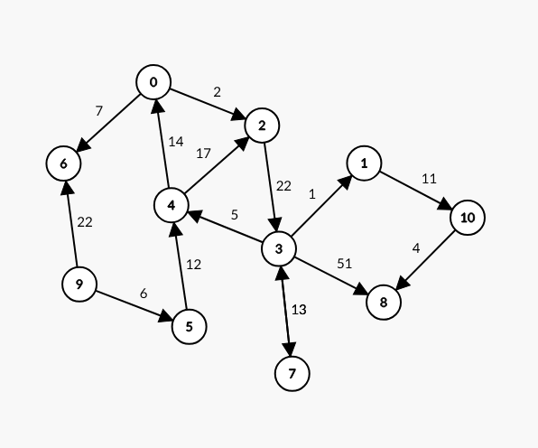

**Run**
```
dotnet run --project ITCS6114.Project2 -- spath ITCS6114.Project2.Tests\Assets\sp-3.txt -s 4
```

**Results**
```
Shortest paths from 4 to:
Node: 0
      { Cost = 14, Edges = 4 -> 0 }
Node: 1
      { Cost = 39, Edges = 4 -> 0 -> 2 -> 3 -> 1 }
Node: 10
      { Cost = 50, Edges = 4 -> 0 -> 2 -> 3 -> 1 -> 10 }
Node: 2
      { Cost = 16, Edges = 4 -> 0 -> 2 }
Node: 3
      { Cost = 38, Edges = 4 -> 0 -> 2 -> 3 }
Node: 4
      { Cost = 0, Edges = 4 }
Node: 6
      { Cost = 21, Edges = 4 -> 0 -> 6 }
Node: 7
      { Cost = 51, Edges = 4 -> 0 -> 2 -> 3 -> 7 }
Node: 8
      { Cost = 54, Edges = 4 -> 0 -> 2 -> 3 -> 1 -> 10 -> 8 }
```

*Note that nodes 9 and 5 are unreachable from node 4, which is why they're not listed.*

#### sp-4.txt

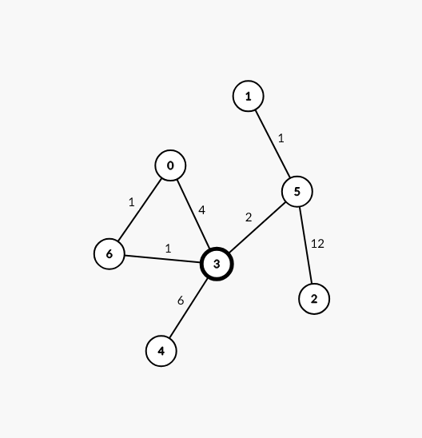

**Run**
```
dotnet run --project ITCS6114.Project2 -- spath ITCS6114.Project2.Tests\Assets\sp-4.txt -s 2
```

**Results**
```
Shortest paths from 2 to:
Node: 0
      { Cost = 16, Edges = 2 -> 5 -> 3 -> 6 -> 0 }
Node: 1
      { Cost = 13, Edges = 2 -> 5 -> 1 }
Node: 2
      { Cost = 0, Edges = 2 }
Node: 3
      { Cost = 14, Edges = 2 -> 5 -> 3 }
Node: 4
      { Cost = 20, Edges = 2 -> 5 -> 3 -> 4 }
Node: 5
      { Cost = 12, Edges = 2 -> 5 }
Node: 6
      { Cost = 15, Edges = 2 -> 5 -> 3 -> 6 }
```

#### sp-5.txt
Large randomly generated graph, too large to include output.

**Run**
```
dotnet run --project ITCS6114.Project2 -- spath ITCS6114.Project2.Tests\Assets\sp-5.txt
```

## Minimum Spanning Tree

> Given a connected, undirected, weighted graph, find a spanning tree using edges that minimizes the total weight. Use Kruskal's algorithm to find Minimum Spanning Tree (MST). You will printout edges of the tree and total cost of minimum spanning tree.

My implementation uses Kruskal's Algorithm for creating a minimum spanning tree from a full graph.

### Run
Requires a graph text file in the format specified in the assignment desc.
```batch
dotnet run --project ITCS6114.Project2 -- mst <filename> [-m <directed|undirected>]
```
ex (should be ran in repository root), uses airport example from slides:
```batch
dotnet run --project ITCS6114.Project2 -- mst ITCS6114.Project2.Tests\Assets\mst-2.txt
```

### Psuedocode

* [Implementation](https://github.com/DanielWillett/ITCS6114.Project2/blob/main/ITCS6114.Project2.Impl/Algorithms/MinimumSpanningTree.cs#L28)

**Dijkstras(graph)**
```
input(undirected graph)
output(mst graph, total cost)

sets = array[graph.nodeCt]

mstGraph = empty Graph

edges = empty PriorityQueue of edges sorted by e.cost

setIndex = 0

foreach node n in graph
    foreach edge e connected to node
        if e.isQueued is true
            continue

        edges.add(e)
        e.isQueued = true

    newNode = mstGraph.addNode(n.value)

    n.replacement = newNode
    n.setIndex = setIndex

    sets[setIndex].count = 1
    sets[setIndex].parent = setIndex

    increment setIndex

totalCost = 0

while edges is not empty
    e = edges.removeMin()

    UpdateSetIndex(e.node1, sets)
    UpdateSetIndex(e.node2, sets)

    if e.node1.setIndex == e.node2.setIndex
        continue

    // if node1's set is larger than node2's set
    if sets[e.node1.setIndex].count > sets[e.node2.setIndex].count
        Union(e.node2, e.node1)
    else
        Union(e.node1, e.node2)

    mstGraph.addPath(e.node1.replacement, e.node2.replacement);

    totalCost = totalCost + e.cost

return (mstGraph, totalCost)
```

**UpdateSetIndex(n, sets)** - Updates the setIndex to apply any set replacements.
```
input(node, sets)

do
    parentSet = sets[node.setIndex].parent
    if parentSet == set
        return

    node.setIndex = parentSet
```

**Union(a, b, sets)** - Add all of set a to set b.
```
input(nodeA - smaller set, nodeB - larger set, sets)

sets[nodeB.setIndex].count = sets[nodeB.setIndex].count + sets[nodeA.setIndex].count
sets[nodeA.setIndex].parent = nodeB.setIndex
```

### Complexity Analysis

> n = # of nodes, m = # of edges

* The first loop iterates over every single edge in the graph - `m`
    * It adds to a priority queue - `log m`
    * Also, for every node, it calls `addNode`, which is a `log n` operation, since my graphs use a sorted array to store nodes and a binary search to insert.
    * Thus, we get `O(m log m + n log n)`
    * To have a minimum spanning tree, `m >= n` must be true, so we can drop `n log n`.
* The queue loop runs `m` times, which calls `UpdateSetIndex` twice, and `addPath` once.
    * It also calls `Union` once if the elements are in a different set. This happens `log m` times.
        * `Union` is `O(1)`.
    * `UpdateSetIndex` can not loop more than `log m` times, so it is also `log m`.
    * So we get `O(3m log m)`, or just `O(m log m)`.
* Thus, our overall time complexity is `O(2(m log m))` or just `O(m log m)`.

The space complexity is only `O(m + n)`, including the output graph.
* My algorithm uses 2 arrays.
    * One to keep track of node information (length `n`).
    * And one to keep track of set information (length `m`).
* The copied graph is also `O(m + n)`.
* Thus, our overall space complexity is `O(2(m + n))` or just `O(m + n)`.

### Data Structures

* **Priority Queue**
    * Used to keep track of the edges with the shortest cost.
    * Makes it so finding the shortest edge is `O(1)` and adding to the queue is `O(log n)`.
    * I'm using the [built-in .NET PriorityQueue](https://learn.microsoft.com/en-us/dotnet/api/system.collections.generic.priorityqueue-2) class for this, which uses an array-based heap.
* **Array**
    * An array is used to store each node's state and each set's state separate from the actual `Graph` classes.
        * `O(1)` access time since the index is stored on the graph node.
        * `O(n + m)` space complexity.

### Tests

#### mst-1.txt

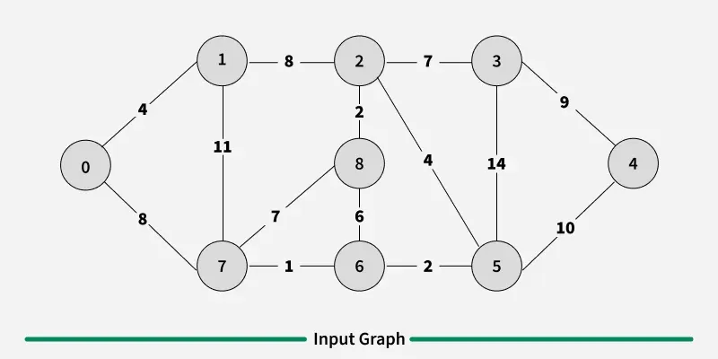

This graph was taken from [GeeksForGeeks](https://www.geeksforgeeks.org/dsa/kruskals-minimum-spanning-tree-algorithm-greedy-algo-2/#illustration).

**Run**
```
dotnet run --project ITCS6114.Project2 -- mst ITCS6114.Project2.Tests\Assets\mst-1.txt
```

**Results**
```
Output Graph:
9 8 U
0 7 8
0 1 4
2 3 7
2 5 4
2 8 2
3 4 9
5 6 2
6 7 1
```
*connections omitted from output*

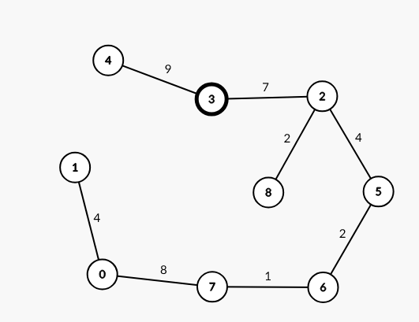

#### mst-2.txt

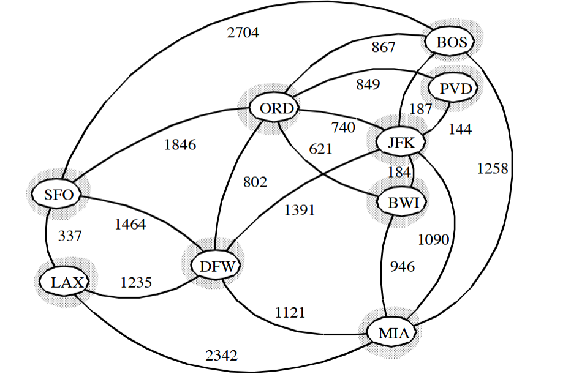

This graph was taken from a slide presented in class.

**Run**
```
dotnet run --project ITCS6114.Project2 -- mst ITCS6114.Project2.Tests\Assets\mst-2.txt
```

**Results**
```
Output Graph:
9 8 U
BOS JFK 187
BWI MIA 946
ORD BWI 621
JFK BWI 184
DFW LAX 1235
ORD DFW 802
PVD JFK 144
SFO LAX 337
```
*connections omitted from output*

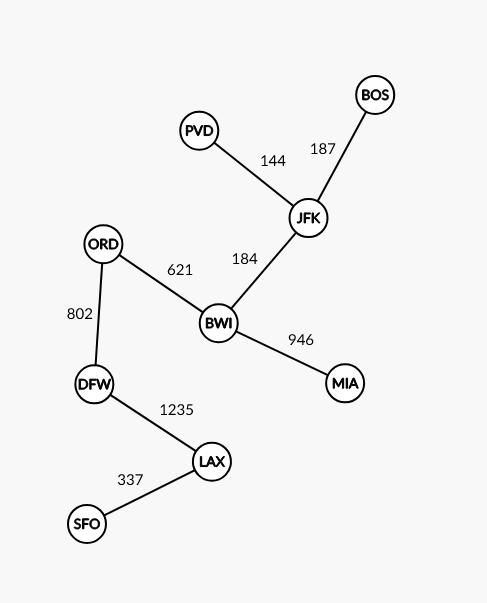

#### mst-3.txt

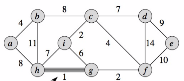

This graph was taken from a slide presented in class.

**Run**
```
dotnet run --project ITCS6114.Project2 -- mst ITCS6114.Project2.Tests\Assets\mst-3.txt
```

**Results**
```
Output Graph:
9 8 U
a h 8
a b 4
c d 7
c f 4
i c 2
d e 9
g f 2
h g 1
```
*connections omitted from output*

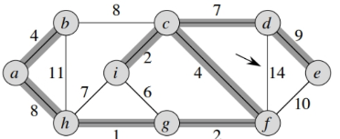

#### mst-4.txt

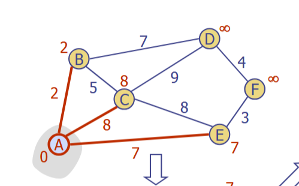

This graph was taken from a slide presented in class.

**Run**
```
dotnet run --project ITCS6114.Project2 -- mst ITCS6114.Project2.Tests\Assets\mst-4.txt
```

**Results**
```
Output Graph:
6 5 U
A B 2
B D 7
B C 5
D F 4
E F 3
```
*connections omitted from output*

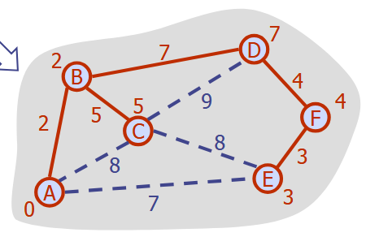

#### mst-5.txt
Large randomly generated graph, too large to include output.

**Run**
```
dotnet run --project ITCS6114.Project2 -- mst ITCS6114.Project2.Tests\Assets\mst-5.txt
```

## Topological Sort

> Given a directed graph G with V vertices and E edges, execute Depth First Search (DFS) on G. If the graph is acyclic, display the topological sorting sequence. If the graph contains cycles, provide all cycles along with their lengths. 

My implementation uses a depth-first search with some extra code to identify cycles when a back-edge is encountered.

### Run
Requires a graph text file in the format specified in the assignment desc.
```batch
dotnet run --project ITCS6114.Project2 -- topo <filename> [-m <directed|undirected>]
```
ex (should be ran in repository root), ts-1, ts-2 are acyclic, ts-3 has cycles:
```batch
dotnet run --project ITCS6114.Project2 -- topo ITCS6114.Project2.Tests\Assets\ts-1.txt
dotnet run --project ITCS6114.Project2 -- topo ITCS6114.Project2.Tests\Assets\ts-3.txt
```

### Psuedocode

* [Implementation](https://github.com/DanielWillett/ITCS6114.Project2/blob/main/ITCS6114.Project2.Impl/Algorithms/TopologicalSort.cs#L30)

**TopologicalSort(graph)**
```
input(directed graph)
output(array of nodes or list of cycles)

sorted = stack of nodes(n = graph.nodeCt);
cycles = list of cycles()

foreach node n in graph
    n.state = 'unvisited'

any = false
foreach node n in graph
    # skip visited nodes or nodes with incoming connections
    if n.state is not 'unvisited' or n.inputs is not ∅
        continue

    any = true
    DfsVisit(n, sorted, cycles)

if any == false
    # this handles the edge case where the entire graph is a cycle
    foreach node n in graph
        # skip visited nodes or nodes with incoming connections
        if n.state is not 'unvisited'
            continue

        if n.inputs is not ∅ and any == true
            continue

        any = true
        DfsVisit(n, sorted, cycles)

return cycles.isEmpty() ? sorted : cycles;
```

**DfsVisit(n, sorted, cycles)**
```
input(node, sorted output array, cycles list)

n.state = 'visiting'

foreach edge e emitting from node
    if e.from same as e.to # self loop
        cycles.add([ e ])
        continue

    if e.to.state == 'unvisited'
        # tree edge
        e.to.predecessor = n
        DfsVisit(e.to, sorted)
    else if e.to.state == 'visiting'
        # back edge
        ResolveCycle(n, e, cycles)


n.state = 'visited'
sorted.push(n)
```

**ResolveCycle(n, e, cycles)**
```
input(cycleEndNode, backEdge, cycles)

cycle = stack of nodes

p = cycleEndNode

repeat

    cycle.add(p)
    p = p.predecessor

until p == backEdge.to

cycles.add(cycle)
```

### Complexity Analysis

> n = # of nodes, m = # of edges

* The first loop initializes the states of all nodes - `n times`
* The second loop calls `DfsVisit` at most once per node - `n times`.
    * `DfsVisit` visits only unvisited edges, so `m times`.
    * We can say this loop is `O(m + n)`, same with the second loop which is basically the exact same
* `ResolveCycle` is at most `O(n)` but can only be called for already visited nodes, so it will never add up to more than `O(m + n)`.

The space complexity is only `O(n)`, including the output graph.
* My algorithm allocates 3 sets of memory ('arrays').
    * One to keep track of node information (length `n`).
    * One to store the sorted values as they're visited (length `n`).
    * One to store cycles, which isn't allocated until a first cycle is found (dynamically sized).
    
### Data Structures

* **Stacks**
    * Used to keep track of the sorted elements.
    * Also used for keeping track of a cycle in `ResolveCycle`.
* **List**
    * Keeps track of cycles as they're found.

### Tests
#### ts-1.txt

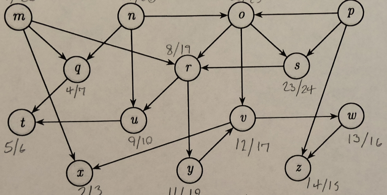

This graph was taken from a handout in class.

**Run**
```
dotnet run --project ITCS6114.Project2 -- topo ITCS6114.Project2.Tests\Assets\ts-1.txt
```

**Results**
```
Sorted: p n o s m q r y v w z x u t
```

#### ts-2.txt

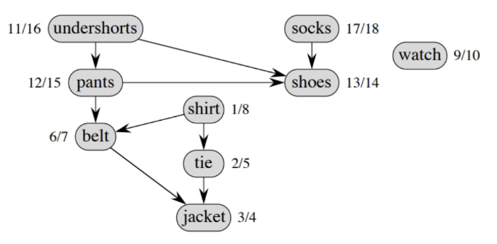

This graph was taken from a slide presented in class.

**Run**
```
dotnet run --project ITCS6114.Project2 -- topo ITCS6114.Project2.Tests\Assets\ts-2.txt
```

**Results**
```
Sorted: watch undershorts pants socks shoes shirt belt tie jacket
```

#### ts-3.txt

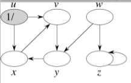

This graph was taken from a slide presented in class.

**Run**
```
dotnet run --project ITCS6114.Project2 -- topo ITCS6114.Project2.Tests\Assets\ts-3.txt
```

**Results**
```
Cycle(s) Detected:
 * x -> v -> y
 * z
```

#### ts-4.txt

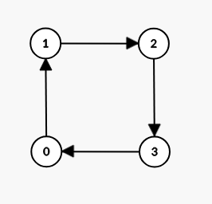

**Run**
```
dotnet run --project ITCS6114.Project2 -- topo ITCS6114.Project2.Tests\Assets\ts-4.txt
```

**Results**
```
Cycle(s) Detected:
 * 0 -> 1 -> 2 -> 3
```

#### ts-5.txt
Large randomly generated graph, too large to include output.

**Run**
```
dotnet run --project ITCS6114.Project2 -- topo ITCS6114.Project2.Tests\Assets\ts-5.txt
```

## Code
Public on GitHub at https://github.com/DanielWillett/ITCS6114.Project2.